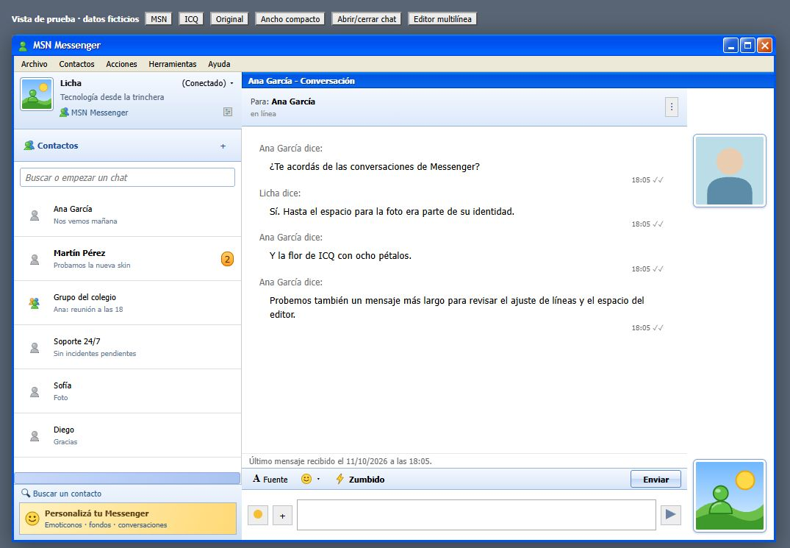
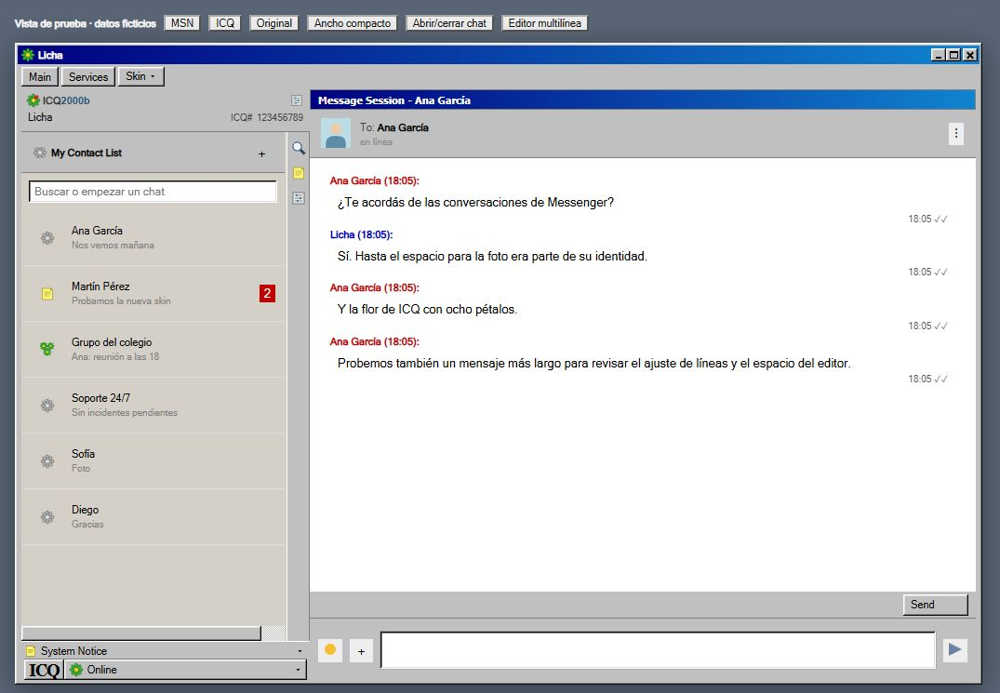

# Primera etapa de fidelidad retro

Fecha: 11/10/2026. Cambios locales en el código; sin publicación ni actualización del instalador distribuido.

Esta entrega mejora la composición integrada. No certifica una copia exacta de MSN 7.5 ni de una build concreta de ICQ 2000b. La lista histórica de ICQ orienta la composición; la ventana de mensajes todavía necesita una referencia exacta.

## Cambios realizados

| Plan | Modificación aplicada | Alcance pendiente |
|---|---|---|
| 03 | Perfil y pie ligados exclusivamente al panel de contactos; conversación con título propio. | Ventanas nativas separadas: prueba 04. |
| 05, 06 | Íconos de lista de 16 px, nombres de 11 px y vistas previas de 10 px; cabeceras más chicas. | Altura de filas, scroll virtualizado y escalas Windows. Se conservaron zoom MSN 0,9 / ICQ 0,86. |
| 07 | Flor ICQ de ocho pétalos; íconos originales para búsqueda y preferencias; muñeco gris sin distintivo de desconexión para presencia desconocida. | Catálogo completo por estado y variantes ópticas comparadas con recursos históricos. |
| 08, 29 | Pulsación de botones clásicos y foco visible en controles nuevos. | Marcos inactivos, maximizado, restaurado y scrollbars completos. |
| 09 | Perfil MSN limitado a contactos, retrato enmarcado, nick/estado/mensaje personal compactos; eliminado correo con contador fijo. | Medidas finales contra captura de la versión elegida. |
| 10 | Eliminadas pestañas y buscador duplicados del marco. Acceso inferior enfoca el buscador real de WhatsApp. | Revestimiento más fiel de la navegación nativa. |
| 11, 12 | Título de conversación separado; geometría observada; fotos laterales MSN ocultas por debajo de 520 px de ancho del chat. | Barra histórica completa y botón Enviar junto al editor, con referencia. Fuente conserva su aviso actual. |
| 14 | Anuncio ficticio compacto exclusivamente en el pie de contactos, sin bounce/blink. | Pieza gráfica y proporción final verificadas; preferencia para ocultarlo. |
| 15 | ICQ gris compacto, My Contact List, ICQuick lateral, System Notice y pie ICQ/estado; eliminados botones amarillos y pestañas sin acción. | Árbol de grupos y contadores fiables. System Notice es decorativo; su flecha abre Services. |
| 16, 17 | Eliminadas etiquetas globales Online/Conectado; contactos con presencia desconocida usan gris. | Detección fiable de presencia real; agrupaciones organizativas. El ícono de grupo solo indica tipo de chat. |
| 18 | Zumbido retirado de la cabecera y la barra de conversación ICQ; conservado como extra en menú/atajo. | Separación explícita de extras en opciones. |
| 20 | Quitada rotación continua de la flor del perfil y animaciones del anuncio. | Alternancia de notificación de mensaje contra referencia. |
| 21 | ICQ con título Message Session, encabezado To:, editor blanco hundido y Send clásico. | Captura de la ventana de mensajes, individual y grupal. |
| 22 | Restituidos hora y entrega/lectura en ICQ; ocultamiento del fondo limitado a elementos gráficos directos. | Matriz real de audio, documentos, citas, reacciones, encuestas y otros medios. |
| 25 | ResizeObserver sobre lista/main/header/footer; box-sizing del overlay; controles ocultos sin chat; edición local con Enter/Escape y protección de Ctrl+G. | Emoji, adjuntos, zoom y paneles sobre una sesión real. Se conservó el polling de respaldo. |
| 27 | ICQ# solo aparece en opciones ICQ. | Diálogos completos según cada programa y restitución de foco. |
| 30 | Login ICQ explica vinculación con WhatsApp; README actualizado; vista sintética reproducible y capturas. | Login y recuperación de sesión en la aplicación real. |

## Integración técnica

- Nuevo src/shared/sidebar.ts: plantillas del perfil, pie y herramientas. Se insertan fuera del árbol de React.
- Nuevo src/wa/css/chrome.css: reserva espacio en los paneles completos, sin alterar las alturas de filas virtualizadas.
- El preload mide cada panel y actualiza coordenadas; reobserva nodos si WhatsApp los reemplaza.
- El main recibe únicamente nick, mensaje personal y UIN por el canal de edición local. Verifica emisor y tipos, normaliza espacios y limita longitudes; UIN acepta dígitos.
- Los botones nuevos abren menús Electron existentes. Se convierten coordenadas del contenido según el zoom. No se implementaron todavía menús HTML retro (26).
- Sin servidor externo, nueva base de datos o reemplazo del compositor de WhatsApp.

## Evidencia visual

Datos ficticios, navegador Chrome, CSS zoom 1. Escenario de 1040 × 690 px, y revisión compacta a 720 px de ancho. Estas capturas muestran la presentación sobre el fixture, no una sesión de WhatsApp real ni su escala Electron.

## Validación ejecutada

- TypeScript: configuraciones node y web aprobadas.
- Compilación de producción con electron-vite aprobada.
- MSN → ICQ → original en la misma instancia del fixture: se eliminan los espacios reservados y overlays retro al volver al original.
- Nick con caracteres <, > y &: se presenta como texto; Enter genera edición local, sin envío ficticio de chat.
- Escape restaura el nick guardado sin nueva edición.
- Ctrl+G dentro del nick no genera envío de zumbido.
- UIN con letras y más de 12 dígitos: se normaliza a 12 dígitos.
- Buscar un contacto enfoca el input nativo del fixture; estado emite solicitud de menú con coordenadas.
- Ancho compacto: retratos ocultos, cabecera alineada al chat y barra dentro de sus límites.
- Editor de 68 → 140 px: barra se reposiciona sobre el footer, sin cubrirlo.
- Sin conversación: permanece el perfil/pie de contactos; herramientas de chat ocultas.
- Sin errores ni advertencias en consola durante la revisión del escenario.

No se enviaron mensajes reales. La apariencia del menú Electron y su transformación de coordenadas requieren prueba en la aplicación. La herramienta de escritorio no consiguió abrirla; el navegador permitió revisar el fixture.

## Reproducir

1. npm run preview:retro
2. Abrir http://127.0.0.1:4173 en un navegador.
3. Alternar skins, ancho compacto, chat y editor. El registro inferior muestra eventos simulados.
4. Para ejecutar la aplicación: npm run dev. Para generar un instalador: npm run dist.

El servidor de prueba escucha solo en 127.0.0.1. No carga web.whatsapp.com; sus contactos, estado, retratos y mensajes son inventados. Los menús se registran como eventos y no simulan el menú nativo.

## Siguiente trabajo del plan

Primero validar esta base en Electron y WhatsApp: filas virtualizadas, borrador al cambiar skin, tamaños, menús, QR, emoji y adjuntos. Después cerrar referencias y reconstruir barras de conversación, estados, menús y diálogos. Mantener pendientes 04, 13, 19, 23, 24, 26 y 28; los restantes cambios marcados aquí son parciales y conservan los criterios del plan original.
